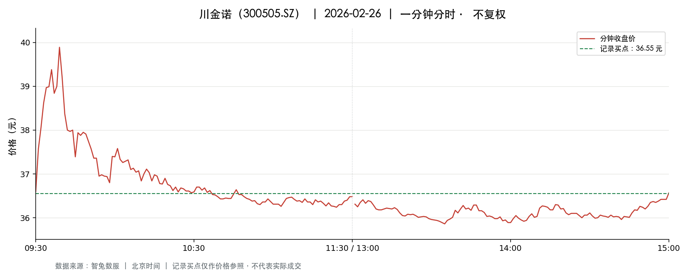
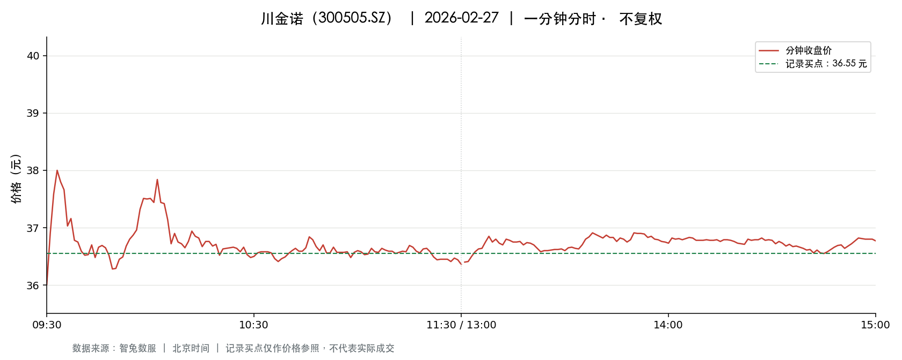

# 川金诺 · 300505.SZ

出票日期：2026-02-26 · [返回当天清单](../README.md)

| 信号 ID | 网站记录买点（元） |
| --- | ---: |
| sig-0084 | 36.55 |

记录买点为网站原值，不代表实际成交。图中绿色虚线只作为价格参照。

## 出票当日 · 2026-02-26

状态：**分钟标签齐全**；241 条分钟记录。

[下载一分钟 CSV](2026-02-26.csv)

数据来源：智兔 API Pro；采集时间：2026-11-09T16:55:16+08:00；北京时间、不复权。

## 下一交易日 · 2026-02-27

状态：**分钟标签齐全**；241 条分钟记录。

[下载一分钟 CSV](2026-02-27.csv)

数据来源：智兔 API Pro；采集时间：2026-11-09T16:55:16+08:00；北京时间、不复权。

## 说明

分时图的红线表示分钟收盘价，绿色虚线表示记录买点；两张图使用相同价格坐标范围。缺失分钟处断开，价格数据不做平滑处理。每分钟最高价和最低价保留在 CSV 中。零成交量的价格标签不代表该分钟存在可成交量。

该档案仅支持核对价格及走势，不提供收益回测。历史整理不证明信号在出票当天已公开。网站区间最高价可能来自更长的持有区间。
